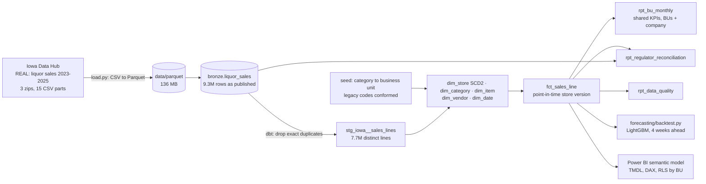

# Retail Enterprise Warehouse: Conformed Dimensions, Shared KPIs & Demand Forecasting

[](https://github.com/Saigwe/retail-enterprise-warehouse/actions/workflows/ci.yml)

> Three years of real Iowa spirits sales (9.3 million published lines) conformed into one Kimball warehouse with five business units sharing one set of KPI definitions. The warehouse ties to the regulator's published total within 0.12%, where the raw file is 23% over because whole months were published twice. On top: a four-week demand forecast backtested on every week of 2025, and a Power BI semantic model with row-level security by business unit.

**Author:** Stanley Igwe, Lead Data (Analytics) Engineer · [Portfolio](https://saigwe.github.io)
**Stack:** Python · DuckDB · Parquet · dbt Core · [dbt-trust-tests](https://github.com/Saigwe/dbt-trust-tests) · LightGBM · Power BI (TMDL) · GitHub Actions
**Status:** ✅ Built on the real data. `dbt build` 43/43, pytest 4/4, CI runs everything on the real files. The Power BI model is written as source but not yet opened in Power BI Desktop (see [Power BI](#power-bi)).

As Lead Data Analytics Engineer at a consumer-audio company I owned the analytics engineering layer of a modernisation that unified product, customer, sales, marketing and operations data across five global business units: Kimball models, shared KPI definitions agreed with senior stakeholders, access controls on sensitive data, and churn and demand forecasting. This repo rebuilds that kind of work on public data. No employer data, code or logic is used.

---

## 90-second summary
| | |
|---|---|
| **Problem** | Each business unit counts sales its own way, master data drifts (renamed stores, recoded categories, vendor spellings), and nobody can say whether the warehouse matches the books. Forecasts built on that data inherit every error. |
| **What I built** | Ingestion of the published yearly files to Parquet; conformed store (SCD2), category, item, vendor and date dimensions; one sales fact joined point-in-time; one KPI model that every business unit and the company total share; a reconciliation to the regulator's published total; a data-quality report; a LightGBM forecast; a Power BI semantic model with business-unit security. |
| **Why it matters** | Every business unit's numbers add up to the company's by construction (tested), the company's number matches the regulator's, and the forecast is trained on data that is actually right. |
| **Proof** | FY2025 sales: warehouse $435.46M vs $434.94M published (+0.12%); raw file +23.1%. Forecasting on the raw file would have meant 44% error instead of 10%. See [Numbers](#numbers). |

## Architecture


## Data
[Iowa Liquor Sales](https://data.iowa.gov/catalog/dataset/1262), published by the Iowa Department of Revenue on the Iowa Data Hub (CC BY): every spirits purchase by an Iowa Class E licensee (grocery, liquor and convenience stores) from the state, by product and date. 2023, 2024 and 2025 are datasets 1260, 1261 and 1262. These are wholesale orders from licensees, not shelf sales to consumers.

| Year | Published rows | Distinct lines | Duplicated share | Sales, published | Sales, warehouse |
|---|---:|---:|---:|---:|---:|
| 2023 | 3,238,302 | 2,639,557 | 18.5% | $550.1M | $446.1M |
| 2024 | 3,154,794 | 2,590,975 | 17.9% | $547.2M | $447.2M |
| 2025 | 2,920,609 | 2,490,613 | 14.7% | $501.6M | $424.8M |

## Conformance: what the warehouse fixes
| Issue in the published data | Size | What the warehouse does |
|---|---:|---|
| Whole months published twice, every field identical (Aug-Oct 2023, Oct-Dec 2024, Aug-Oct 2025) | 1,592,560 rows, $280.7M | Dropped in staging; counted in `rpt_data_quality` |
| `invoice_id` documented as unique, but reused on lines with different items or amounts | 35,988 ids | A content hash is the line key; the reuse is reported |
| Legacy parent category codes used alongside their current codes until early 2024 | 4 codes | Conformed to the current code in a reviewed seed |
| Singular and plural spellings of the same category | 4 codes | One canonical name |
| Stores renamed, moved, or re-zoned | 164 stores, 216 extra versions | SCD2 store dimension; sales join the version valid on the order date |
| Vendor name spellings | 3 vendors | Latest spelling |
| No state cost or retail price | all of 2023-2024, 42% of 2025 lines | Margin reported only where cost exists, with its coverage |
| Returns and credits | 9,061 negative lines, -$1.37M | Kept in totals |

## Shared KPIs and the bus matrix
One model, `rpt_bu_monthly`, defines sales, litres, bottles, price per litre, active stores, gross margin and cost coverage for each business unit and for the company (a grouping-sets row), so the definitions can't drift. A test requires the five business units to add up to the company total every month.

| Business process | Date | Store | Item | Category / business unit | Vendor |
|---|:---:|:---:|:---:|:---:|:---:|
| Licensee purchases (`fct_sales_line`) | ✓ | ✓ (SCD2) | ✓ | ✓ | ✓ |
| Monthly KPIs (`rpt_bu_monthly`) | ✓ (month) |  |  | ✓ |  |
| Demand forecast (weekly) | ✓ (week) | ✓ (county) |  | ✓ |  |

Business units come from the publisher's own category code hierarchy (101 whiskey, 102 and 106 agave and rum, 103 vodka, 108 liqueurs), mapped in `seeds/category_business_unit.csv` where a reviewer can challenge each line.

## Tests
- **Reconciliation to the regulator:** FY2025 sales must be within 1% of the Iowa Department of Revenue's published $434,938,128 ([source](https://www.dmcityview.com/civic-skinny/2025/12/31/alcohol-sales-down-tax-dollars-paid-to-newspapers-continue-reimagining-education-progresses-pet-adoptions-break-record-and-holiday-drinks-confuse/)). The raw file fails this by 23%.
- **Business units add up to the company** every month (`trust_tests.reconciles_to`), and the fact ties to the de-duplicated staging lines.
- **SCD2:** store versions never overlap or leave gaps and exactly one is current (`trust_tests.scd2_valid`); every sale points at the version valid on its order date (`trust_tests.point_in_time_valid`).
- Keys, relationships, accepted business units, unique KPI grain.
- **pytest:** the Power BI export matches the warehouse KPIs exactly; every exported category has a business unit; holiday weeks; forecast sanity.

## Numbers
From `make all` on the real files, 26 Oct 2026.

**Reconciliation to the regulator (FY2025, July 2024 to June 2025)**

| | Sales | vs published | Gallons | vs published |
|---|---:|---:|---:|---:|
| Published (Iowa Department of Revenue) | $434,938,128 | | 6,023,961 | |
| Warehouse | $435,458,077 | +0.12% | 5,979,792 | -0.73% |
| Raw published file | $535,388,490 | +23.1% | | |

**Business units, 2025**

| Business unit | Sales | Litres | Gross margin (where cost exists) |
|---|---:|---:|---:|
| Whiskey | $135.8M | 5.69M | 34.0% |
| Vodka & Neutral Spirits | $94.3M | 7.27M | 34.7% |
| Agave & Rum | $78.1M | 3.56M | 34.2% |
| Liqueurs & Cordials | $67.5M | 2.81M | 34.2% |
| Gin, Brandy & Other | $49.1M | 2.73M | 34.3% |
| **Company** | **$424.8M** | **22.06M** | **34.3%** (on 52% of sales) |

Margin sits at about 34% in every unit, consistent with a fixed state markup, so in this market margin is a pricing policy rather than a business-unit lever. Whiskey earns the most; vodka moves the most volume.

**Demand forecast: weekly sales four weeks ahead, every week of 2025 (WAPE, lower is better)**

| Level | LightGBM | Same week last year | Mean of weeks t-4..t-7 | LightGBM trained on the raw file |
|---|---:|---:|---:|---:|
| State | **7.8%** | 8.0% | 8.4% | 43.0% |
| Business units (pooled) | **10.1%** | 10.9% | 12.8% | 44.2% |
| Whiskey | **9.0%** | 10.8% | 13.6% | 41.3% |
| Vodka & Neutral Spirits | 10.2% | **9.6%** | 12.2% | 42.1% |
| Agave & Rum | **10.3%** | 10.5% | 15.0% | 41.3% |
| Liqueurs & Cordials | **6.8%** | 7.0% | 8.5% | 44.8% |
| Gin, Brandy & Other | 17.3% | 19.4% | **14.1%** | 59.5% |

One global model across 495 business-unit × county series, refit monthly, features at least four weeks old. It beats both baselines overall, but only modestly against same-week-last-year at state level (7.8% vs 8.0%), and it loses on Gin, Brandy & Other, where seasonal gift packs make last year a poor guide and the recent average wins. **The bigger lesson is the last column:** the same model trained on the published file, duplicated months included, misses by 43–60%.

| Pipeline | Value |
|---|---|
| Load: 3 zips, 15 CSV parts to Parquet | about 20 s for 9.3M rows (136 MB Parquet) |
| dbt | 11 models and 2 seeds, 30 data tests: 43/43 pass in about 30 s |
| Forecast backtest | about 20 s |
| Power BI export | 3.0M daily rows, 30 MB |

## Power BI
`powerbi/RetailWarehouse.SemanticModel` is a TMDL semantic model (Power BI's text format for models in git): Sales, Store, Category and Date tables reading the Parquet export, three relationships, ten DAX measures that match the warehouse KPIs (sales, litres, bottles, price per litre, gross margin and its coverage, active stores, year on year), and row-level security with one role per business unit plus an all-units role.

**Not yet verified in Power BI Desktop**, which isn't installed on the machine I built this on. To use it: run `make powerbi-data`, set the `DataFolder` parameter to `powerbi/data`, open the model in Power BI Desktop (or Tabular Editor), and build the report pages. The roadmap tracks it.

## How to run
Requires **Python 3.12** (what CI uses), `make`, and about 3 GB of free disk for the download.
```bash
python -m venv .venv && source .venv/bin/activate   # Windows: .venv\Scripts\activate
pip install -r requirements.txt
make all
```

## Roadmap
- [x] Real data ingestion to Parquet; conformed dimensions with SCD2 stores; shared KPIs; reconciliation to the regulator; data-quality report
- [x] Four-week demand forecast with baselines and the raw-file comparison
- [x] Power BI semantic model in TMDL: measures, relationships, row-level security
- [ ] Open the model in Power BI Desktop, verify it, and build the report pages (needs Power BI Desktop)
- [ ] Report the duplicated months to the publisher
- [ ] Slim CI: build only modified models against the production manifest
- [ ] 3-minute Loom walkthrough ([script ready](docs/walkthrough.md))

## Data and licence
- **Iowa Liquor Sales:** Iowa Department of Revenue, Alcoholic Beverages Division, via the [Iowa Data Hub](https://data.iowa.gov), CC BY.
- **Business-unit mapping:** mine, from the publisher's category codes.
- **Code:** MIT (see `LICENSE`).
